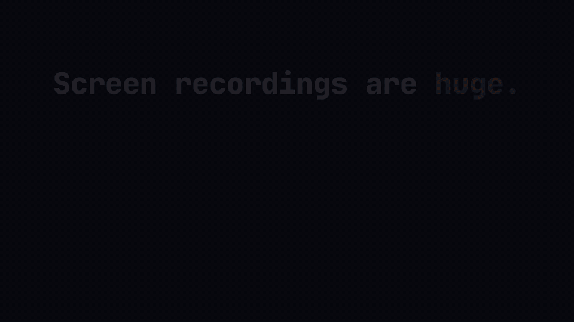

# Flea Shrink Video

[](docs/demo.mp4)

<sub>Click the animation for the video with sound.</sub>

A [Flea](https://github.com/thisisgm/flea) plugin that adds **Shrink Video…** to the right-click
menu of video files. Choosing it opens Omarchy's menu to pick, in order:

| Step | Options |
| --- | --- |
| Format | MP4 H.264 (plays everywhere), MP4 H.265 (smaller), WebM VP9 (web), GIF (silent loop) |
| Resolution | Original, 1080p, 720p, 480p, 360p (never upscales) |
| Frame rate | Original, 60, 30, 24, 15 (GIF: 15, 10; never raises the source rate) |
| Quality | High, Medium, Low (skipped for GIF) |

Escape at any step cancels. The output is written next to the original as
`<name>-<resolution>-<fps>fps-<quality>.<ext>`. The original is never touched, and an existing
output is never overwritten.

Encoding runs in the background as a transient systemd user unit, so a long video is not cut by
Flea's 30-second plugin request limit. Notifications show when it starts and the size before and
after when it finishes. Several selected videos are encoded one after another with the same choices.

## Requirements

- Flea 0.4.0 or newer
- Omarchy (`omarchy-menu-select`)
- `ffmpeg` with `libx264`, `libx265`, `libvpx-vp9`; `systemd-run`, `notify-send`
- Python 3

## Install

```sh
flea plugin add https://github.com/FelipeMayerDev/flea-shrink-video.git
flea plugin enable felipemayerdev.shrink-video
```

Restart Flea if an already open window does not show the new rows.

Update with `flea plugin update felipemayerdev.shrink-video`.

## Uninstall

```sh
flea plugin remove felipemayerdev.shrink-video
```

## Tweaking

The formats, resolutions, frame rates and quality-to-CRF mapping are the tables at the top of
`plugin.py`. Lower CRF means better quality and a bigger file. `./test.sh` encodes a generated clip
with every format and checks the outputs.

## License

MIT
